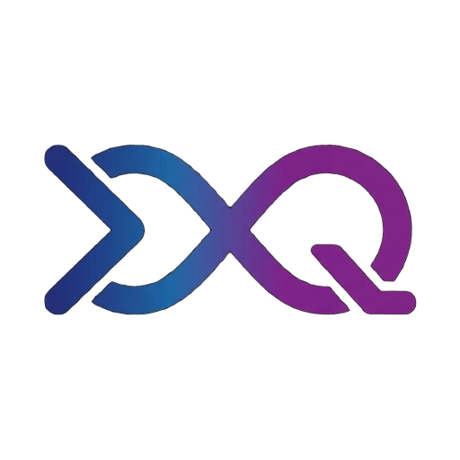
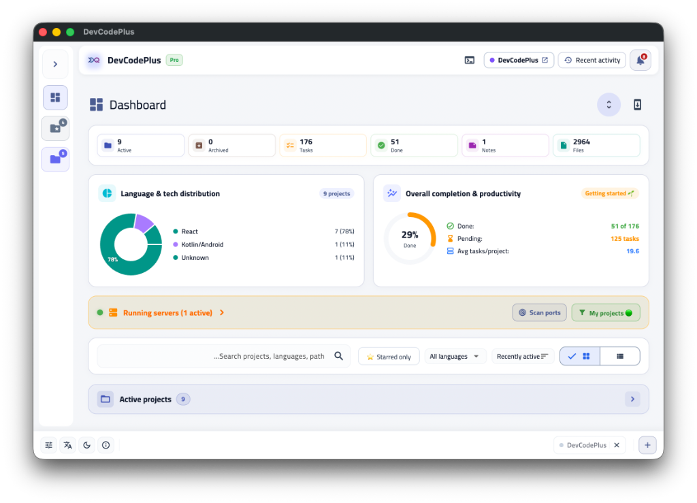
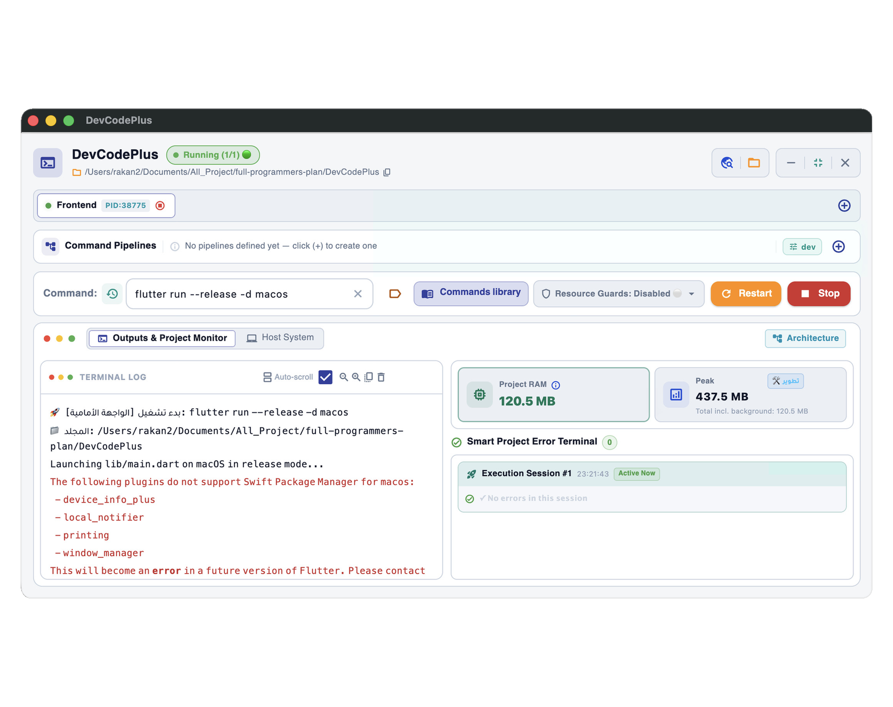
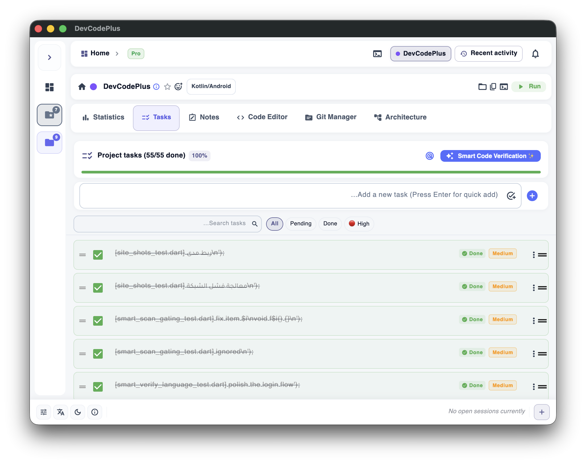
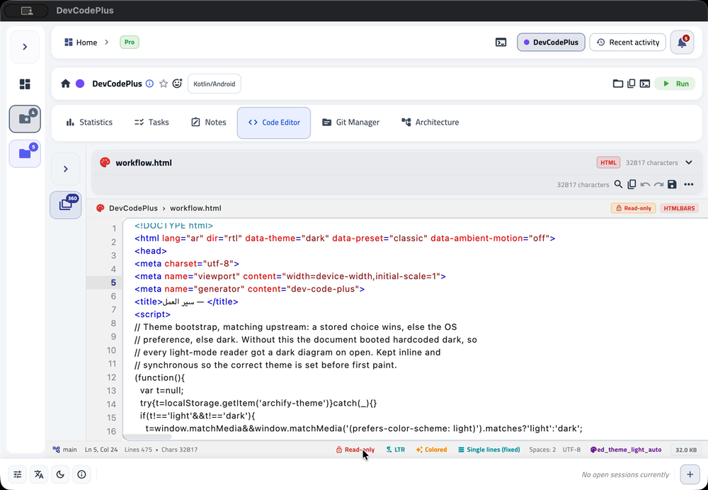
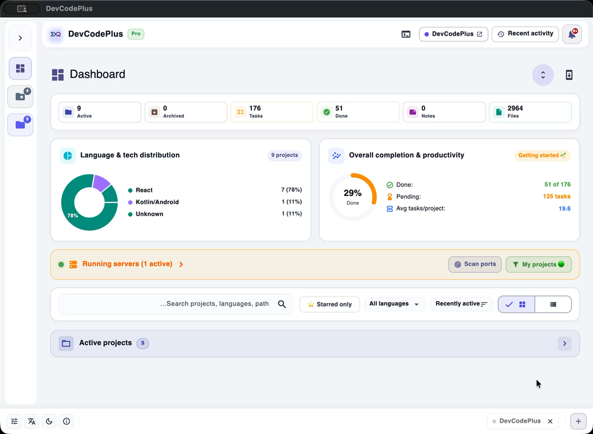
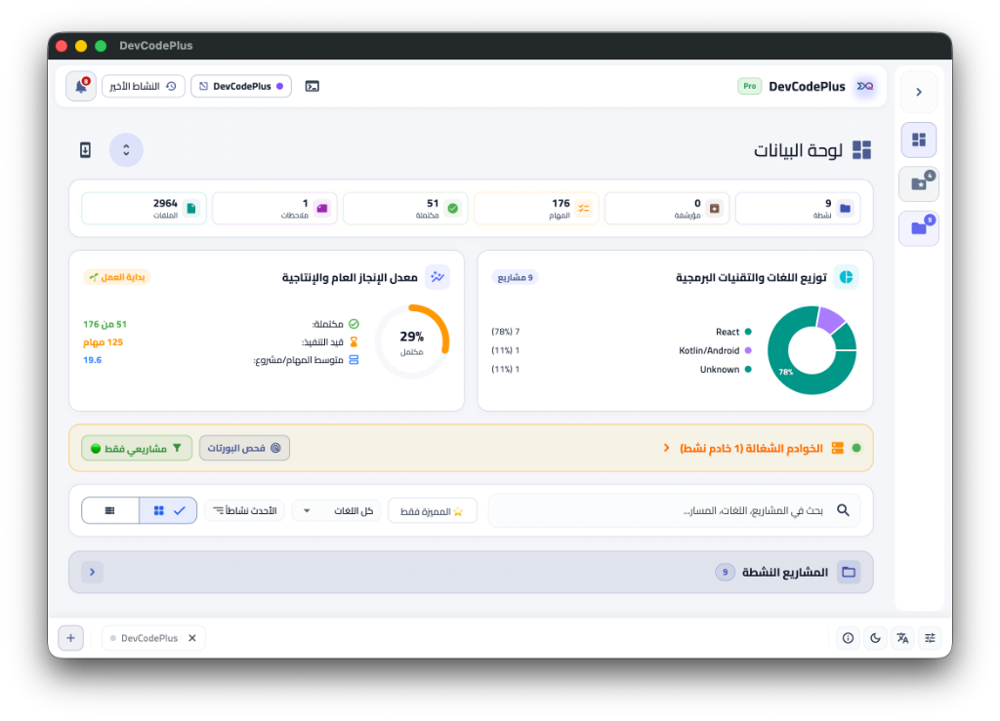

<div align="center">



# DevCodePlus

**The Developer Workspace — run, organise and document your projects in one place.**

<a href="https://github.com/SaadSoftW/DevCodePlus/releases/latest"></a>
<a href="https://devcodeplus.com"></a>

<a href="LICENSE"></a>



</div>

A local-first desktop app for developers who juggle many projects. Start your
servers with one click and watch their ports, pull `TODO` / `FIXME` out of the
codebase, keep projects, tasks and notes in an encrypted on-device database, and
map the architecture your code actually has — all without anything leaving your
machine.

---

## Screenshots

| One-Click Runner | Tasks |
|:---:|:---:|
|  |  |

| Docs Reader | UI Customization |
|:---:|:---:|
|  |  |

## Features

- **One-Click Runner** — launch and stop project servers instantly, and monitor their ports live.
- **Task Manager** — extracts `TODO` / `FIXME` directly from your source into a focused list.
- **Smart Note** — capture project notes that are safe and fully reversible.
- **Docs Reader** — read a project's documentation inside the workspace, next to your work.
- **Deep Analysis** — architecture, sequence, workflow, dataflow and lifecycle maps generated from your real source files with `file:line` evidence.
- **Local-first & private** — projects, tasks and notes live in an encrypted (AES-256) local database. Analysis runs on your device, not in the cloud.
- **Cross-platform** — the same workspace on macOS, Windows and Linux.

## Download

Get the latest build for your platform. The recommended installer is listed first.

| Platform | Recommended | Portable / alternative |
|---|---|---|
| **macOS 12+** (Intel & Apple Silicon) | [DevCodePlus-macOS.dmg](https://devcodeplus.com/downloads/DevCodePlus-macOS.dmg) | [portable .zip](https://devcodeplus.com/downloads/DevCodePlus-macOS-portable.zip) |
| **Windows 10/11 (x64)** | [DevCodePlus-Windows-Setup.exe](https://devcodeplus.com/downloads/DevCodePlus-Windows-Setup.exe) | [portable .zip](https://devcodeplus.com/downloads/DevCodePlus-Windows-x64-portable.zip) |
| **Linux (x64)** | [DevCodePlus-Linux-amd64.deb](https://devcodeplus.com/downloads/DevCodePlus-Linux-amd64.deb) | [.tar.gz](https://devcodeplus.com/downloads/DevCodePlus-Linux-x64.tar.gz) |

All builds and release notes are also listed under
[**Releases**](https://github.com/SaadSoftW/DevCodePlus/releases/latest). The
newest version is always available at a stable URL, so the download links above
never change.

## System requirements

| | Minimum |
|---|---|
| **macOS** | macOS 12.0 (Monterey) or newer — universal (Intel & Apple Silicon) |
| **Windows** | Windows 10 or 11 (x64) |
| **Linux** | 64-bit (x64), glibc-based distribution |

## Verify your download

Every release ships with checksums so you can confirm the installer is intact.

- Master list: **[sha256sums.txt](https://devcodeplus.com/downloads/sha256sums.txt)**
- Per-file hashes: `*.sha256` on the [Releases](https://github.com/SaadSoftW/DevCodePlus/releases/latest) page

```sh
# macOS
shasum -a 256 DevCodePlus-macOS.dmg

# Linux
sha256sum DevCodePlus-Linux-amd64.deb

# Windows (PowerShell)
Get-FileHash .\DevCodePlus-Windows-Setup.exe -Algorithm SHA256
```

Compare the output with the published hash **before** running any installer.

## Pricing

DevCodePlus is a commercial product with a free trial.

- **Monthly** — $4.99 / month
- **Yearly** — $49.99 / year

Billing is processed in SAR; USD is shown for reference. See
[devcodeplus.com/pricing](https://devcodeplus.com/pricing) for current details.

## Community & support

- **Website** — [devcodeplus.com](https://devcodeplus.com)
- **Bug reports & feature requests** — [open an issue](https://github.com/SaadSoftW/DevCodePlus/issues)
- **Contact** — [devcodeplus.com](https://devcodeplus.com) (support link in the footer)

## License

DevCodePlus is **proprietary software**. See [LICENSE](LICENSE) for the full
terms. This repository is the official **download and update channel**; the
application source code is not published here.

---

<div align="center">
<sub>This repository contains only the released programs. The application source lives in a private repository and is built by CI.</sub>
</div>

<br>

<!-- ─────────────────────────────  العربية  ───────────────────────────── -->

<div align="center">

<h2 dir="rtl">DevCodePlus — مساحة عمل المطوّر</h2>
<p dir="rtl"><b>شغّل مشاريعك، نظّمها، ووثّقها في مكان واحد.</b></p>

</div>

<br>

<div dir="rtl">

تطبيق مكتبي **محلي أولًا** للمطوّرين الذين يديرون مشاريع كثيرة: شغّل سيرفراتك
بنقرة واحدة وراقب منافذها، واستخرج تعليقات `TODO` و`FIXME` من كودك، واحفظ
مشاريعك ومهامك وملاحظاتك في قاعدة بيانات محلية **مشفّرة**، واقرأ المعمارية
التي يملكها كودك فعلاً — دون أن تخرج أي بيانات من جهازك.

### أبرز الميزات

- **مُشغّل بنقرة واحدة** — تشغيل وإيقاف سيرفرات مشاريعك فورًا مع مراقبة المنافذ مباشرة.
- **مدير المهام** — يستخرج `TODO` / `FIXME` من الكود إلى قائمة مركّزة.
- **ملاحظات ذكية** — تدوين ملاحظات المشروع بشكل آمن وقابل للتراجع.
- **قارئ المستندات** — اقرأ توثيق المشروع داخل مساحة العمل بجوار عملك.
- **تحليل معماري (Deep Analysis)** — خرائط المعمارية والتسلسل وسير العمل وتدفق البيانات ودورة الحياة مستخرجة من ملفاتك الفعلية مع أدلة `ملف:سطر`.
- **محلي وخاص** — المشاريع والمهام والملاحظات في قاعدة بيانات مشفّرة (AES-256)، والتحليل يعمل على جهازك لا في السحابة.
- **متعدد المنصات** — نفس التجربة على macOS و Windows و Linux.

### التحميل

| المنصة | الموصى به | بديل |
|---|---|---|
| **macOS 12+** (Intel و Apple Silicon) | [‎.dmg](https://devcodeplus.com/downloads/DevCodePlus-macOS.dmg) | [‎.zip محمول](https://devcodeplus.com/downloads/DevCodePlus-macOS-portable.zip) |
| **Windows 10/11 (x64)** | [‎Setup.exe](https://devcodeplus.com/downloads/DevCodePlus-Windows-Setup.exe) | [‎.zip محمول](https://devcodeplus.com/downloads/DevCodePlus-Windows-x64-portable.zip) |
| **Linux (x64)** | [‎.deb](https://devcodeplus.com/downloads/DevCodePlus-Linux-amd64.deb) | [‎.tar.gz](https://devcodeplus.com/downloads/DevCodePlus-Linux-x64.tar.gz) |

كل الإصدارات وسجلات التغيير على صفحة [**Releases**](https://github.com/SaadSoftW/DevCodePlus/releases/latest)، وروابط التحميل أعلاه ثابتة لا تتغيّر.

### التحقق من الملف

- القائمة الكاملة: **[sha256sums.txt](https://devcodeplus.com/downloads/sha256sums.txt)**
- تحقّق من البصمة **قبل** تشغيل أي مثبّت.

### الأسعار

منتج تجاري مع فترة تجربة مجانية: **‎4.99$ شهريًا** أو **‎49.99$ سنويًا** (الخصم بالريال، والدولار للاستدلال). التفاصيل على [devcodeplus.com/pricing](https://devcodeplus.com/pricing).

### الدعم

- الموقع: [devcodeplus.com](https://devcodeplus.com)
- البلاغات والاقتراحات: [Issues](https://github.com/SaadSoftW/DevCodePlus/issues)

### الترخيص

برنامج **مغلق المصدر**؛ راجع [LICENSE](LICENSE). هذا المستودع هو **قناة التحميل والتحديث الرسمية** فقط، والكود المصدري غير منشور هنا.

</div>
